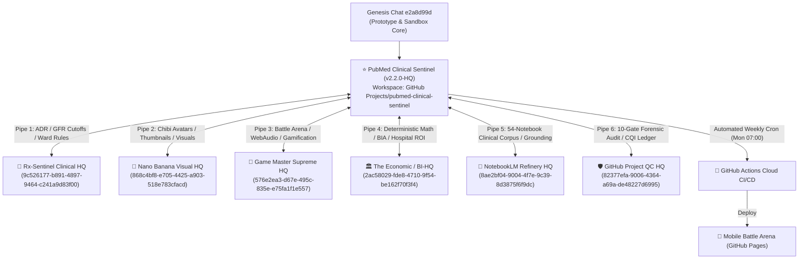

# 🤝 ALLIED HQ HANDSHAKE REGISTRY & KNOWLEDGE PIPELINE SPECIFICATION
**Project:** `pubmed-clinical-sentinel` (v2.2.0-HQ)  
**Lead Investigator:** ภก.รัฐนนท์ แสงไทยทวีพร (เภสัชกรชำนาญการ, ประธานทีม IM โรงพยาบาลเสิงสาง)  
**Permanent Repository Path:** `c:\Users\LENOVO\OneDrive\Desktop\รวมไฟล์งาน\GitHub Projects\pubmed-clinical-sentinel`  
**GitHub Origin:** [https://github.com/NutCodeLaw/pubmed-clinical-sentinel](https://github.com/NutCodeLaw/pubmed-clinical-sentinel)  
**Live Battle Arena:** [https://nutcodelaw.github.io/pubmed-clinical-sentinel/](https://nutcodelaw.github.io/pubmed-clinical-sentinel/)  
**Coordinating Conversation ID:** `5196702a-14ab-4cfd-83a3-a1969c13b896`  
**Origin & Genesis Conversation ID:** `e2a8d99d-ff21-4ff9-91be-ae3456187ad0`  

---

> [!IMPORTANT]
> **🚀 INFRASTRUCTURE UPGRADE BROADCAST (2026-11-12 15:21):**  
> ท่านประธานได้ทำการเปิดใช้งาน **"Set up billing (Pay-as-you-go Tier 1)"** บน Google AI Studio เรียบร้อยแล้ว!  
> ✅ **ปลดล็อคข้อจำกัดโควตา (Quota Limitation Cleared):** ขยาย Rate Limits สำหรับโมเดลตระกูล Gemini ทั้งหมด (Gemini 3.8 Flash, Gemini Pro, Gemini Argon)  
> ✅ **ผลลัพธ์ต่อเครือข่าย 6 Allied HQs:** ทุกศูนย์บัญชาการสามารถเรียกใช้งานการสังเคราะห์หลักฐานทางคลินิก วิเคราะห์สถิติ BIA และผลิตสื่อมัลติมีเดียได้อย่างเต็มกำลัง ไร้ปัญหาติด Rate Limit / Daily Quota Cap!

---

## 🌐 เครือข่ายท่อส่งต่อความรู้ (The 6-Allied HQ Knowledge Grid)
โครงการ **PubMed Clinical Sentinel** ได้ทำการเชื่อมต่อท่อส่งต่อความรู้แบบสองทาง (Bi-Directional Knowledge Pipe) เข้ากับ 6 ศูนย์บัญชาการแม่บท เพื่อให้ทุกแชทในเครือข่ายมีความรู้เท่าเทียมกัน (Omni-Domain Parity) และสามารถเรียกใช้งานร่วมกันได้อย่างไร้รอยต่อ:

---

## 📡 รายละเอียดท่อส่งต่อความรู้รายศูนย์ (Data Pipeline Contracts)

### 1. 🏥 Rx-Sentinel Clinical & ADR HQ (`9c526177-b891-4897-9464-c241a9d83f00`)
* **บทบาท:** ผู้เชี่ยวชาญบริบาลเภสัชกรรมคลินิก วินิจฉัยการแพ้ยา (Naranjo Score, SCARs), ขนาดยาตามค่าไต (GFR/CrCl cutoffs), ข้อห้ามใช้ และแนวทางรักษา รพ.เสิงสาง
* **ท่อส่งเข้า Sentinel (Inbound Knowledge):**
  * กฎการตัดขนาดยาและการปรับยาตามค่าไต (เช่น SGLT2i ห้ามเริ่มเมื่อ eGFR < 20, Warfarin INR Target 2.0-3.0, Pyrazinamide ห้ามลด dose เพื่อแก้ปวดข้อ)
  * Checklist คัดกรองความปลอดภัยยา High-Alert Drug
* **ท่อส่งออกจาก Sentinel (Outbound Intelligence):**
  * ส่งแจ้งเตือนเปเปอร์ใหม่ด้านความปลอดภัยยาและ Drug Alerts สดใหม่รายสัปดาห์

### 2. 🍌 Nano Banana Rapid Visual HQ (`868c4bf8-e705-4425-a903-518e783cfacd`)
* **บทบาท:** ศูนย์บัญชาการผลิตภาพด่วน 5 มิติ (Nano Banana Image Gen, Visual Receipts, YouTube/Mobile Thumbnails, Canva Pro Templates)
* **ท่อส่งเข้า Sentinel (Inbound Knowledge):**
  * คาแรคเตอร์มาสคอตเภสัชกรจิ๋ว (Chibi Pharmacist Mascot)
  * โครงสร้างภาพการ์ดประลองยา และธีม Canva Pro Template: `https://canva.link/v9g5tfxdg349vbg`
* **ท่อส่งออกจาก Sentinel (Outbound Intelligence):**
  * Payload ข้อมูลเปรียบเทียบยาคู่เอก เพื่อให้นำไป Generate Infographic หรือ Visual Storyboard ได้ทันที

### 3. 👑 Game Master Supreme HQ (`576e2ea3-d67e-495c-835e-e75fa1f1e557`)
* **บทบาท:** สถาปัตยกรรม Game Studio ไร้ขีดจำกัด, Gamification Engine, การสังเคราะห์เสียง Web Audio แบบ Real-time โดยไม่ต้องพึ่งพาไฟล์เสียงภายนอก
* **ท่อส่งเข้า Sentinel (Inbound Knowledge):**
  * โค้ดเสียงสังเคราะห์ระฆังเวทีมวย (Boxing Bell Sound Synthesizer via Web Audio API)
  * กฎการดีไซน์ "ศึกมวยคู่เอก (3-Round Showdown Arena)" และหลอดพลังชีวิต (HP Bars)
* **ท่อส่งออกจาก Sentinel (Outbound Intelligence):**
  * อัตราส่วนหลักฐานทางคลินิก (Evidence Weights, Sample Size N, Effect Size) เพื่อคำนวณเป็นค่าพลังในเกม

### 4. 🏛️ The Economic / BI-HQ (`2ac58029-fde8-4710-9f54-be162f70f3f4`)
* **บทบาท:** ศูนย์บัญชาการวิเคราะห์ธุรกิจและการเงิน (BI-HQ), ระบบคิดเลขแบบ Deterministic Math 100% ด้วย Python, การคำนวณ Budget Impact Analysis (BIA) และความคุ้มค่าระดับโรงพยาบาล
* **ท่อส่งเข้า Sentinel (Inbound Knowledge):**
  * สูตรคณิตศาสตร์ Deterministic BIA สำหรับประเมินงบประมาณค่ายา (Drug Budget Impact Model)
  * กลไก TTL Data Freshness Guard ป้องกันการนำข้อมูลเก่ามาวิเคราะห์
* **ท่อส่งออกจาก Sentinel (Outbound Intelligence):**
  * ราคาเฉลี่ยต่อ Defined Daily Dose (DDD) และตัวเลข Clinical Efficacy เพื่อนำไปคำนวณ ROI การรักษา

### 5. 🧠 NotebookLM Knowledge & Clean-Room Refinery HQ (`8ae2bf04-9004-4f7e-9c39-8d3875f6f9dc`)
* **บทบาท:** ศูนย์บริหารจัดการคลังความรู้ 54-Notebook บน Google NotebookLM, ระบบกลั่นกรองหลักฐาน Clean-Room Evidence Distillery ป้องกัน Context Rot
* **ท่อส่งเข้า Sentinel (Inbound Knowledge):**
  * ความรู้บริบทเดิมของโรงพยาบาลเสิงสาง (DR-001 ถึง DR-010) และฐานความรู้ CPG ระดับประเทศ
  * มาตรฐานการอ้างอิงหลักฐานแบบ Verbatim Grounded Citations
* **ท่อส่งออกจาก Sentinel (Outbound Intelligence):**
  * PMID, DOI, และ Full-Text Abstract ใหม่ที่ผ่านการคัดกรองแล้ว เพื่อนำไป Ingest สู่สมอง Google NotebookLM แบบอัตโนมัติ

### 6. 🛡️ GitHub Project QC HQ (`82377efa-9006-4364-a69a-de48227d6995`)
* **บทบาท:** ศูนย์ตรวจสอบคุณภาพอิสระและนวัตกรรมความปลอดภัยซอฟต์แวร์ (Independent Audit & CQI Division), รัน 10-Gate Forensic Audit Pipeline
* **ท่อส่งเข้า Sentinel (Inbound Knowledge):**
  * 10-Gate Automated Audit Engine (`qc_audit_runner.py`), กฎสกัดกั้นบัคถาวร CQI Vault, และการตรวจสอบความปลอดภัยระดับผ่าตัด
* **ท่อส่งออกจาก Sentinel (Outbound Intelligence):**
  * รหัสสถานะ Git, โครงสร้าง Payload ข้าม HQ, และข้อบกพร่องที่ตรวจพบเพื่อถอดบทเรียนทางวิศวกรรมซอฟต์แวร์

---

## 🛠️ วิธีการส่งสัญญาณ Handshake ข้ามแชท (Inter-HQ Handshake Directive)
เมื่อท่านประธานหรือแชทอื่นต้องการเชื่อมต่อหรือเรียกดูข้อมูลของโปรเจกต์นี้ ให้พิมพ์คำสั่งสั้นๆ:
> **`เชื่อมต่อกับ pubmed-clinical-sentinel`**  
> หรือระบุ Directory: `c:\Users\LENOVO\OneDrive\Desktop\รวมไฟล์งาน\GitHub Projects\pubmed-clinical-sentinel`

ระบบในทุกแชทจะอ่านไฟล์ `project_manifest.json` และ `ALLIED_HQ_HANDSHAKE_REGISTRY.json` เพื่อทำความเข้าใจบริบท สิทธิ และท่อข้อมูลได้ทันที 100%!
